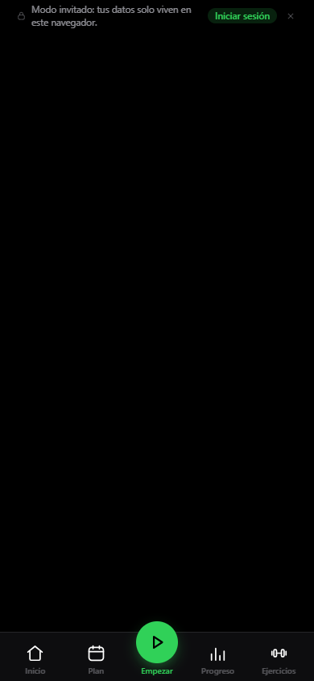

# Auditoría E2E de OpenGym — 20 octubre 2026

Se encontró y examinó la app real en `http://localhost:8080/#/home`, primero en el navegador integrado de Codex y después con Playwright CLI 0.1.19 + Edge en perfiles efímeros independientes. La interfaz informa **v1.4.1**; el checkout estaba en `666d9080`. No se ha demostrado que el contenedor corresponda exactamente a ese commit. No se cambió código de producto ni se tocaron los documentos de trabajo que ya estaban sin seguimiento.

La sesión original de invitado del navegador integrado se conservó. Rutinas, entrenamientos, peso y medidas usados aquí son ficticios y pertenecen a los perfiles de auditoría. La API respondió `ok:true`, `users:0`, `writable:true`. El 401 de `/api/me` durante el arranque sin cuenta es esperable; no equivale a una excepción de React.

## Entregables y ejecución

- [Casos de prueba y cobertura](test-cases.md): condiciones, resultados esperados y estado por escenario.
- [Skill mantenible](../../../.agents/skills/verify-opengym/SKILL.md): lanzamiento, doctor, conducción, evidencia y limpieza.
- [Mapa de funciones](../../../.agents/skills/verify-opengym/features/README.md): cinco familias funcionales y sus puntos de entrada.
- [Inventario de rutas observado](evidence/route-survey.log): 27 rutas/subrutas, contenido visible y destino final.
- [Reproducciones de fallos](evidence/regressions.log): resultados de DOM, teclado y advertencia de React.

Desde la raíz del repositorio, con el stack local disponible:

```powershell
powershell -NoProfile -ExecutionPolicy Bypass -File .agents/skills/verify-opengym/helpers/run.ps1
```

El runner abre una sesión nueva, ejecuta el recorrido, comprueba el JSON descargado y cierra únicamente su navegador. Sale con error si falta una comprobación. Conserva capturas, snapshots y copia ficticia bajo `.playwright-cli/`, directorio ignorado por Git. El resultado revisado de esta auditoría se conserva en [evidence](evidence/).

**Resultado final: PASS, 17 comprobaciones de UI y validaciones del JSON exportado.** Se ejecutó el runner instalado, se confirmó que cerró su sesión y que las capturas y el backup sobrevivieron a la limpieza. Ver [salida del runner](evidence/runner.log) y [resultado estructurado con snapshots](evidence/guest-proof.json). La matriz define 78 escenarios; no afirma que los 78 estén ejecutados. La evidencia conservada incluye 47 capturas. Se cerraron además las dos sesiones exploratorias; `playwright-cli list` quedó vacío y el navegador original de Codex siguió mostrando cero entrenamientos y ningún pesaje.

## Hallazgos reproducidos

### P2 — El acceso directo a Coach intake deja una pantalla vacía

Con un invitado, abrir `/#/coach/intake` y esperar no redirige a Inicio: queda la barra de navegación y el aviso de invitado, sin encabezado ni formulario. `/coach` y `/admin` sí redirigieron a Inicio; `/coach/setup` y recordatorios no disponibles llevaron a Ajustes.

La consola registra `You should call navigate() in a React.useEffect(), not when your component is first rendered.` El código de [CoachIntake.jsx](../../../frontend/src/views/CoachIntake.jsx) llama `nav('/home', { replace: true })` durante render y devuelve `null` cuando Coach no está disponible. La coincidencia entre reproducción y código apunta a esa redirección como causa; revisar también la carga inicial de configuración antes de corregirla.

Impacto: enlaces directos o favoritos a esa ruta dejan al usuario sin contenido. Se puede recuperar con Inicio. Corrección propuesta: redirección declarativa o efecto posterior a la carga, con regresión de acceso frío y navegación interna para invitado y cuenta sin Coach.



### P2 — La hoja de detalle de ejercicio permite que el foco salga al fondo

Ejercicios > buscar `squat` > abrir `sentadilla (squat)`. Con la hoja abierta, se contaron **cero dialogs**; el foco estaba fuera de `#modal-root`. Al pulsar Tab, el foco pasó a un botón `Plan` del catálogo subyacente. Escape sí cerró la hoja correctamente.

El contenedor compartido en [Modals.jsx](../../../frontend/src/components/Modals.jsx) renderiza `.sheet`/`.center` sin semántica de diálogo ni gestión completa de foco. La reproducción se hizo en el detalle del catálogo; el alcance sobre otras hojas es un riesgo por el componente compartido, no una prueba exhaustiva de todas ellas.

Impacto: navegación por teclado y lector de pantalla confusa; controles tapados siguen recibiendo foco. Corrección propuesta: nombre accesible, rol/modalidad apropiados, entrada y retorno del foco, fondo inerte y navegación de foco dentro de la hoja, respetando hojas apiladas y botón Atrás.

### P2 — Iniciar una rutina desde el selector no es accesible por teclado

En Empezar > Otras rutinas, `E2E CLI Routine` se renderiza como `<div class="item">` con `onClick`, sin `role` ni `tabindex`. Funciona con clic, pero no ofrece el comportamiento nativo de un botón. Se confirmó en DOM y en [Workout.jsx](../../../frontend/src/views/Workout.jsx), sección `Other routines`.

Impacto: ese punto de entrada no es alcanzable como control por Tab/Enter. Corrección propuesta: botón nativo con estilo existente y nombre comprensible. El test usa texto exacto como adaptación al comportamiento actual; no debe ocultar este defecto de accesibilidad.

## Comportamientos correctos observados

- Entrada de invitado y estados vacíos de Inicio, Plan y peso.
- Catálogo: búsqueda sin resultados, búsqueda de sentadilla, detalle e instrucciones, cierre con Escape.
- Creación automática de rutina, añadido desde el selector, persistencia de nombre y ejercicios al recargar.
- Asignación de rutina a lunes y persistencia del horario.
- Entrenamiento con tres series, minimizar/reanudar, restauración tras recarga, hoja automática al acabar y resumen final.
- Registro terminado visible en Historial, apertura del detalle y actualización de Progreso.
- Peso ficticio de 72,5 kg; medida de cintura de 85 cm; rechazo del formulario de medidas vacío y persistencia tras recarga.
- Búsqueda de ajustes, persistencia del tema claro y exportación JSON con validación de valores y de que ya no hay sesión activa.

El recorrido automatizado añade las comprobaciones de ajustes y exportación indicadas en su resultado final. Su prueba de exportación contrasta valores del archivo real con las acciones hechas por la UI, sin insertar datos mediante setters internos.

## Modelo funcional que guía las pruebas

La app React usa HashRouter. `App.jsx` enumera las rutas; `TabBar.jsx` ofrece Inicio, Plan, Empezar/Seguir, Progreso y Ejercicios. La UI contiene numerosas hojas que conservan la página de fondo; por eso los selectores deben acotarse a navegación o `#modal-root`.

`useStore.js` mantiene el estado persistente; `useUI.js` las hojas y estados transitorios. Para invitados, `gym_state_v1` guarda la copia local; una sesión activa es distinta de un entrenamiento finalizado. Las pruebas ejercitan UI, recarga y exportación como tres observaciones complementarias. Leer un snapshot final no demuestra por sí solo que una mutación se haya guardado.

El frontend incluye muchas pruebas Vitest de dominio y componentes. No se encontró un runner E2E de Playwright ya configurado en `frontend/package.json`. El nuevo recorrido usa `playwright-cli run-code`: no introduce dependencias ni afirma ser una suite `@playwright/test` o estar integrado en CI.

Plan soporta semana fija y rotación, rutinas con varios ejercicios y reglas de progresión. Las decisiones de carga y lectura de sesiones pertenecen a helpers puros de `src/lib/`; esta auditoría no modifica esas reglas ni valida recomendaciones de entrenamiento por la apariencia de sus gráficas.

Las fotos de progreso se vinculan a entrenamientos guardados. El registro del gimnasio contiene tarjetas/QR; no es el mismo concepto que guardar una sesión de entrenamiento. La traducción «Registrarse» puede resultar ambigua en español; es una observación de copy, no un fallo funcional probado.

## Límites de cobertura

El inventario de 27 rutas es cobertura de renderizado, no una certificación de todas sus acciones. Los escenarios pendientes están identificados en la matriz: carga de planes, rotación completa, superseries, progresión entre sesiones, cancelación y edición de sesiones, importación/restauración, fotos/vídeos, QR/cámara, uso offline/PWA y comportamiento en dispositivo real.

No se crearon cuentas, passkeys, credenciales de Coach, suscripciones push ni sesiones de administración. Autenticación, sincronización entre dispositivos, MCP y shells Android/iOS requieren sus propias condiciones y pruebas. No se ejecutaron las suites unitarias ni builds porque no se cambió código de producto.

La emulación de 390 × 844 comprueba el viewport, no Safari/iOS ni Android nativo. La sesión nativa de Codex se inspeccionó visualmente; el recorrido repetible se ejecutó en Edge con Playwright CLI. Windows sandbox cerraba Edge al arrancar: la prueba usó ejecución de host aprobada, sin cambiar protecciones del sistema.

Para mantener el mapa al cambiar la app, usar `/maintain-verification-skill`.
